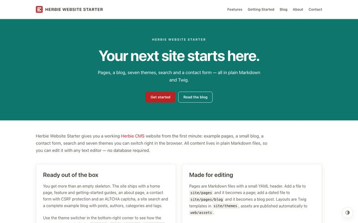
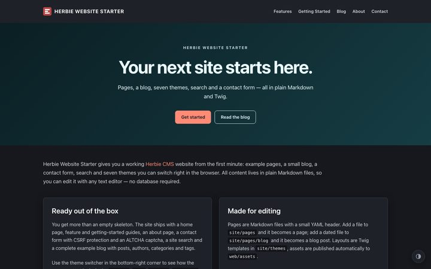
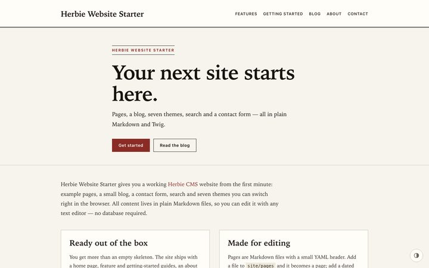
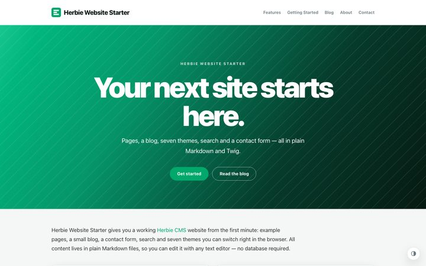
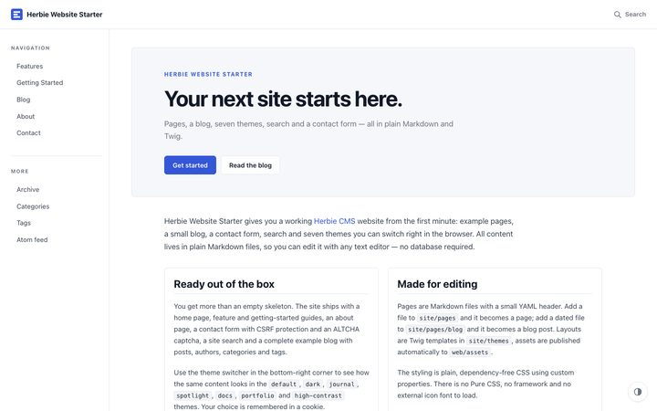
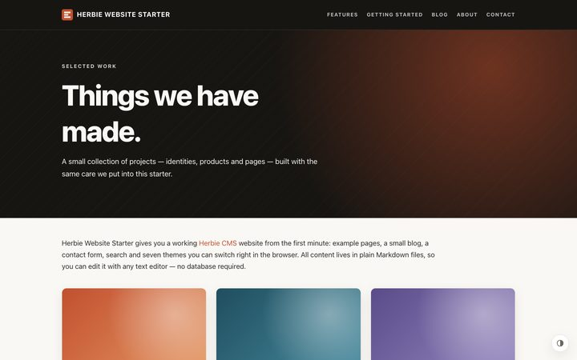
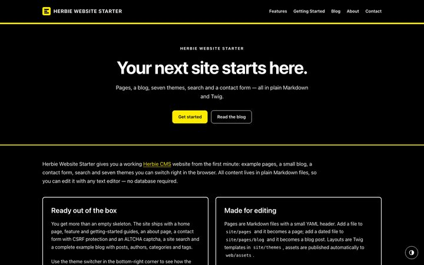

[](https://packagist.org/packages/getherbie/start-website)
[](https://github.com/getherbie/start-website/releases)
[](https://github.com/getherbie/start-website/blob/master/LICENCE.md)
[](https://packagist.org/packages/getherbie/start-website)

# Herbie Website Starter

> Set up a Herbie website in minutes 👌

Seven themes, example pages, a small blog, contact form and site search.

## What's Included

* [Herbie CMS](https://github.com/getherbie/herbie) with Twig and Markdown
* Docker Compose with PHP 8.3 by default (8.3–8.6 supported)
* Example pages and a blog with posts, authors, categories, tags, archive and Atom feed
* Seven themes and a floating switcher: `default`, `dark`, `journal`, `spotlight`, `docs`, `portfolio`, `high-contrast`
* Dependency-free CSS with custom properties — no framework, no icon font
* Contact form with CSRF token and ALTCHA captcha
* Site search with a sidebar form
* `noindex, nofollow` by default

## Quick Start

    docker run --rm -v "$PWD":/app composer create-project --ignore-platform-reqs getherbie/start-website mywebsite
    cd mywebsite
    docker compose up website

Open <http://localhost:8888>.

<details>
<summary>Without Docker (PHP & Composer required)</summary>

    composer create-project getherbie/start-website mywebsite
    cd mywebsite/web
    php -S localhost:8888 index.php

Optional: `HERBIE_DEBUG=1 php -S localhost:8888 index.php` for debug output, or
`XDEBUG_MODE=debug php -S localhost:8888 index.php` for Xdebug.

</details>

## Themes

| | | |
|:---:|:---:|:---:|
| [](docs/screenshots/default.jpg)<br>`default` | [](docs/screenshots/dark.jpg)<br>`dark` | [](docs/screenshots/journal.jpg)<br>`journal` |
| [](docs/screenshots/spotlight.jpg)<br>`spotlight` | [](docs/screenshots/docs.jpg)<br>`docs` | [](docs/screenshots/portfolio.jpg)<br>`portfolio` |
| [](docs/screenshots/high-contrast.jpg)<br>`high-contrast` | | |

Click a screenshot to open the full-size version.

The bottom-right switcher is a plain `<details>` element: no JavaScript, no space
in any design. It keeps the current URL and query parameters, stores the choice in
a cookie, and validates it against `site/data/site.json` (unknown values fall back
to `default`).

* `dark` — colour scheme; one `css/theme.css`.
* `journal` — serif typography and a centred reading column.
* `spotlight` — gradient hero and a card grid.
* `docs` — top bar and fixed navigation rail via a `main.twig` override.
* `portfolio` — dark gallery shell and a `home.twig` project grid.
* `high-contrast` — white or yellow on black, strong borders and focus rings.

Shared assets live in `site/themes/default`; children set `themeParent: default`
and load `css/theme.css`, then `css/extensions.css`. To add a theme, create those
CSS files and add the name to `site/data/site.json`. Copy a Twig template only if
you need different markup.

Each switcher entry shows a description from `themeDescriptions` and a `ZIP` link
with the same self-contained folder as the export command — created on the fly
without a PHP zip extension.

### Exporting a standalone theme

```sh
php vendor/bin/herbie export-theme journal    # or --all
```

The result is `dist/themes/<name>/`, a full copy with no parent theme needed.
Delete an existing folder to refresh it.

Author portraits are hand-written SVGs in `site/media/img/authors/`, referenced by
`avatar` in `site/data/authors.json`. Link lists for the footer and sidebars live
in `site/data/footer.json`.

## Blog

Posts are Markdown files in `site/pages/blog` with `layout: post`, `type: post`,
`date`, `author_id`, `categories`, `tags` and `abstract`. The index, archive,
author, tag and category pages and the Atom feed are generated automatically;
lists are paginated with six posts per page.

Authors come from `site/data/authors.json` (keyed by `author_id`). Routes are
provided by the local `blog` plugin and the URL rules in `site/config/main.php`;
`blog_terms()` supplies the sidebar lists. The feed is a normal page at
`site/pages/blog/feed.xml`.

## Reducing the starter

* **Blog only.** Delete the static pages `2-features.md`, `3-getting-started.md`,
  `4-about.md` and `9-contact.md`, their menu entries in `site/data/menu.json` and
  their link lists in `site/data/footer.json`. Replace `index.md` with a short
  intro linking to the blog.
* **One page.** Delete `site/pages/blog/`, remove `blog` from `enabledPlugins` and
  `components.urlManager.rules` in `site/config/main.php`, and drop the blog links
  from `site/data/menu.json` and `site/data/footer.json`. Remove `layout: home`
  from `index.md` for the plain layout.

Themes, CSS and the contact form stay the same in both variants.

## Deployment

Pushes to `master` and `develop` run the smoke tests, then deploy over SSH
(see `.github/workflows/ci.yml`).

* **Variables:** `SSH_HOST`, `SSH_TARGET` — use a dedicated target directory; its
  contents are replaced.
* **Secrets:** `SSH_USERNAME`, `SSH_PRIVATE_KEY` (optionally `SSH_KEY_PASSPHRASE`,
  `SSH_FINGERPRINT`), `SMTP_RECIPIENT`, `SMTP_HOST`, `SMTP_USERNAME`, `SMTP_PASSWORD`.

Create the deploy key outside the repository:

    ssh-keygen -t ed25519 -a 200 -C "github-actions@getherbie/start-website" -f ~/.ssh/start-website-deploy

Add `~/.ssh/start-website-deploy.pub` to the hosting account's
`~/.ssh/authorized_keys` and store the private key in `SSH_PRIVATE_KEY`. No SSH
password is needed.

CI installs with `--no-dev`, generates `site/config/main.php` from
`main.dist.php` (fresh CSRF/captcha secrets) and uploads `composer.json`,
`composer.lock`, `site`, `vendor` and `web`. Document root: `web/`. Writable:
`site/runtime/cache`, `site/runtime/log` and `web/cache`.

## Development

    git clone https://github.com/getherbie/start-website.git
    cd start-website
    cp site/config/main.dist.php site/config/main.php
    docker compose up website

Open <http://localhost:8888>.

    docker compose run --rm install    # install Composer dependencies
    docker compose run --rm bash       # open a shell

Set `PHP_VERSION` to 8.3–8.6 (default 8.3), e.g.
`PHP_VERSION=8.6 docker compose up website`.

<details>
<summary>Without Docker (PHP & Composer required)</summary>

    git clone https://github.com/getherbie/start-website.git
    cd start-website
    cp site/config/main.dist.php site/config/main.php
    composer install
    cd web
    php -S localhost:8888 index.php

</details>

## Smoke Tests

With the site running, `php tests/smoke.php` checks all themes and routes, the
switcher, the image cache and the exports. Set `SMOKE_BASE_URL` for another
address. A local `site/config/main.php` must exist; CI creates one from
`main.dist.php` with test values. The same checks run in CI.

## Contact Form Configuration

`site/config/main.dist.php` is the versioned template; `site/config/main.php` is
generated and git-ignored. Copy the template locally and fill in your values.
Deployment replaces the six `<plugin_contact_*>` placeholders from the secrets
above, generates fresh CSRF/captcha secrets and uses SMTP port 587 with STARTTLS.
No credentials are stored in Git.

## Search Engine Indexing

`site/extend/middlewares_app/noindex.php` sends `X-Robots-Tag: noindex, nofollow`
for every response, including downloads. Delete it to allow indexing.

## More Information

For more information, see <https://herbie.tebe.ch>.
